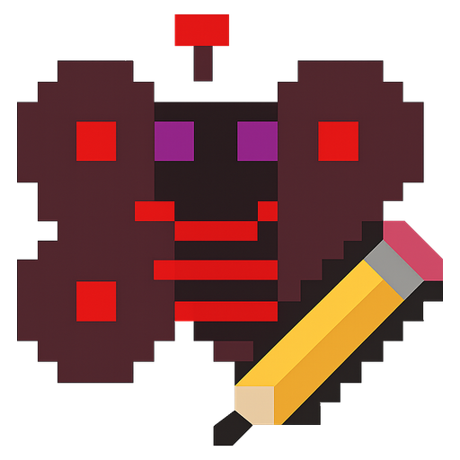
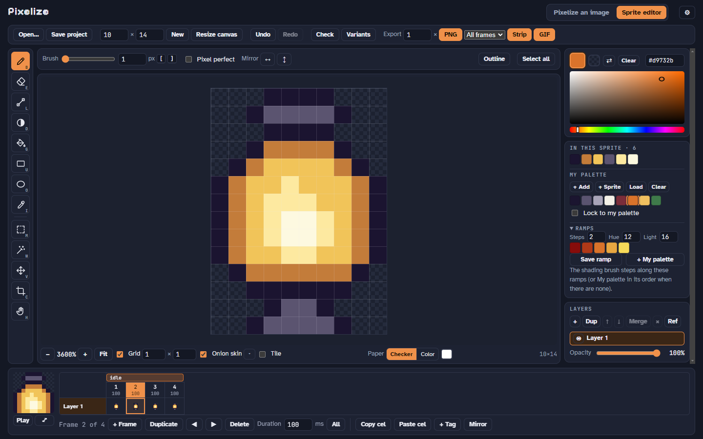
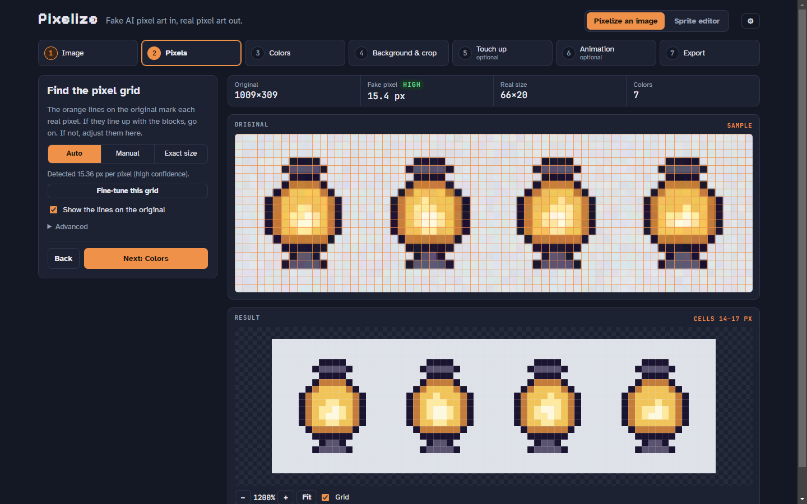
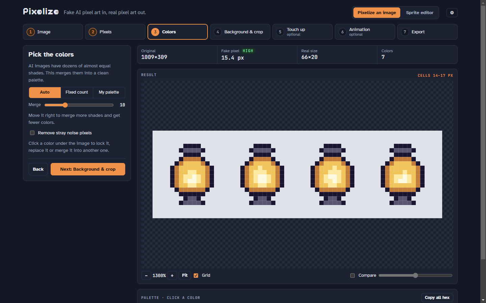
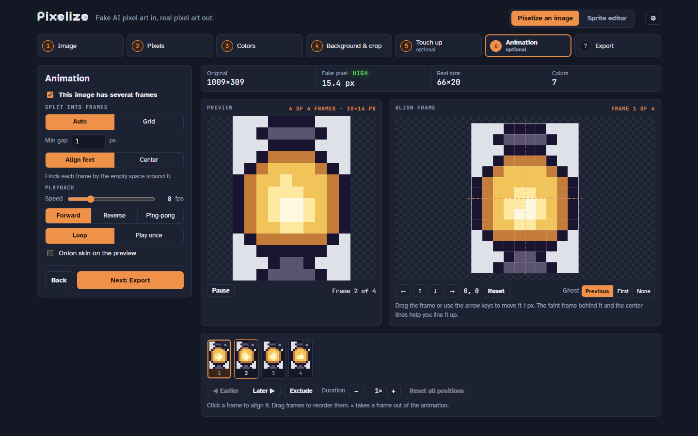
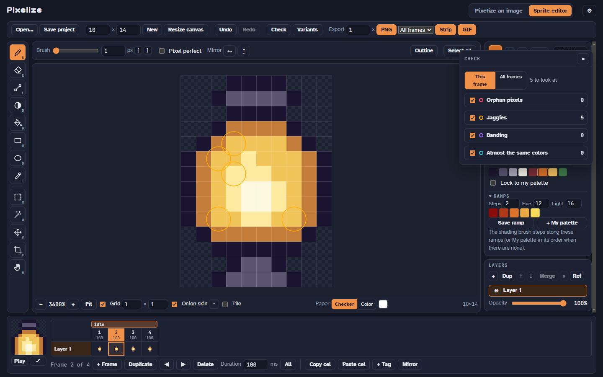
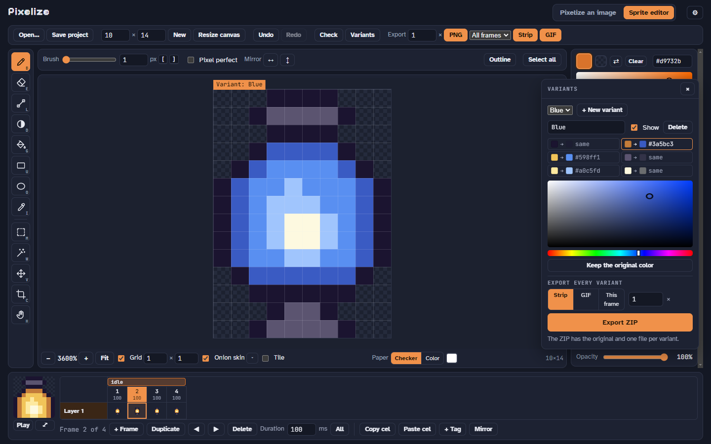
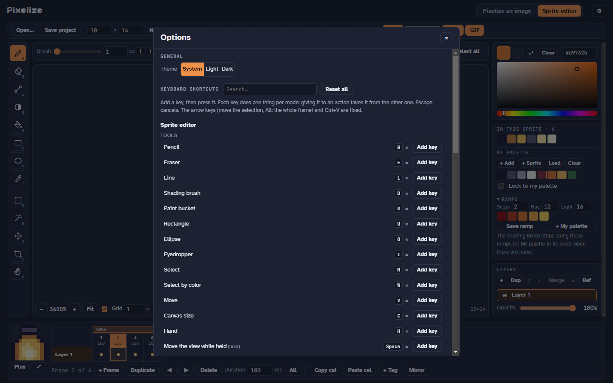

<p align="center">
  
</p>

<h1 align="center">Pixelize</h1>

<p align="center">
  <b>Turn fake AI pixel art into real pixel art, then draw, animate and polish your sprites.</b><br>
  A free, open source pixel art tool for the web and the desktop.
</p>

<p align="center">
  <a href="https://github.com/KennethLG/Pixelize/actions/workflows/ci.yml"></a>
  <a href="LICENSE"></a>
  
</p>

<p align="center">
  
</p>

Pixelize has two halves, one click apart:

- **Pixelize an image** takes an AI image that only *looks* like pixel art (big blocky "pixels" of uneven size, slightly noisy colors) and rebuilds it at its true resolution, with a clean palette, a transparent background and its animation frames.
- **Sprite editor** draws and animates sprites from scratch, with layers, frames, tags and tools made for pixel art.

Everything runs locally: nothing is uploaded.

## Pixelize an image

<p align="center">
  
</p>

A step-by-step flow: **Image → Pixels → Colors → Background & crop → Touch up → Animation → Export.**

- **Finds the grid** on its own (with a confidence rating), or set the pixel size, offset or exact output size yourself.
- **Cleans the colors:** merges near-identical shades, keeps a fixed count, or snaps to your own palette (PNG, `.hex`, `.gpl`, Lospec exports). Lock, replace or merge any color.
- **Removes the background** around the art (or everywhere) and **crops** the empty space.
- **Touch up** single pixels, with a before/after slider.
- **Splits spritesheets** into frames, lines them up (drag a frame pixel by pixel over a ghost of the previous one), and plays them.
- **Exports** PNG (1× or scaled), a GameMaker `_stripN.png` strip, a sheet, a frames ZIP or an animated GIF. Batch mode processes many images at once.

<table>
  <tr>
    <td></td>
    <td></td>
  </tr>
</table>

## Sprite editor

- **Drawing:** pencil (with a *pixel perfect* mode), eraser, line, rectangle, ellipse, paint bucket (fill an area or replace a color everywhere), eyedropper, and an in-app color picker. Brush sizes, symmetry (left/right, top/bottom) and a **tile mode** that wraps strokes around the edges.
- **Selections:** rectangle and by color; move, scale, flip and rotate them; cut, copy and paste (also images from other apps). One-click **outline** around the art.
- **Smart palette:** hue-shifted **ramps** built from any color, a **shading brush** that steps one shade lighter or darker along them, and a **palette lock** that keeps everything you paint inside your palette.
- **Animation:** a layers × frames **timeline**, cels you can copy into other frames, **tags** (idle, walk…) with their own playback direction, **mirrored** copies of a walk cycle, a full **onion skin**, a quick flip to the previous frame, and a floating **preview at game scale** over a background image.
- **Check:** finds orphan pixels, jaggies, banding and colors that are almost the same, and takes you to each one.
- **Variants:** color swaps of the whole sprite (red team, blue team, elite) exported all at once.
- **Layers** with opacity and **reference images** that are never exported, a resizable canvas, and `.pixelize` project files.

<table>
  <tr>
    <td></td>
    <td></td>
  </tr>
</table>

Every keyboard shortcut can be changed in **Options** (⚙ in the header), which also switches between the light and dark themes.

<p align="center">
  
</p>

## Get it

- **Desktop (Windows):** download the installer or the portable `.exe` from [Releases](https://github.com/KennethLG/Pixelize/releases), or build it yourself (below).
- **Web:** build it and open `dist/pixelize.html` in a browser. It is a single file and works offline.
- **Command line:** `npm run cli -- image.png` writes `image_pixel.png` and a scaled preview (`npm run cli -- --help` lists the options).

## Build from source

You need [Node.js](https://nodejs.org/) 20.17 or newer.

```bash
git clone https://github.com/KennethLG/Pixelize.git
cd Pixelize
npm install
npm run dev            # live app at http://localhost:5173
npm test               # the core tests
npm run build          # one-file web app in dist/pixelize.html
npm run desktop        # the desktop app (Electron)
npm run desktop:dist   # Windows installer and portable exe in release/
```

## Contributing

Bug reports, ideas and pull requests are welcome. [CONTRIBUTING.md](CONTRIBUTING.md) explains how the code is organized, the few rules it follows, and how to run the checks before you open a pull request.

## License

[MIT](LICENSE). The fonts (Pixelify Sans, Atkinson Hyperlegible, JetBrains Mono) are under the SIL Open Font License. The butterfly in the icon comes from *SearchingLight*, a game by the same author.
